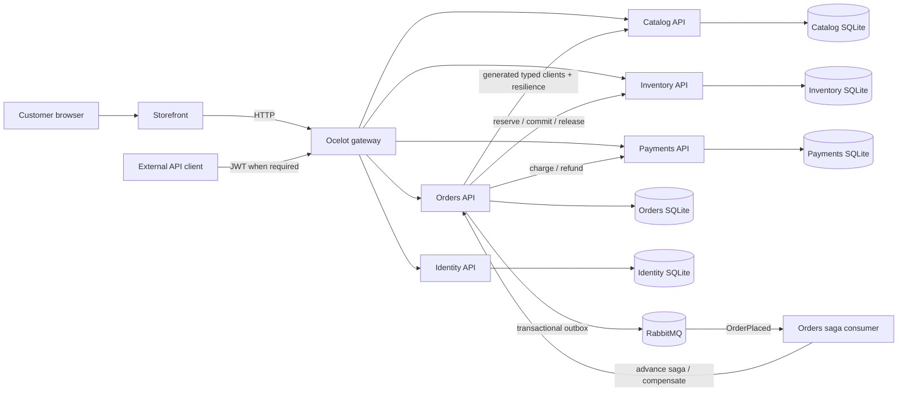

# Store Platform

ASP.NET Core store platform capstone: Catalog, Inventory, Orders, Payments, Identity, Ocelot gateway, Storefront, SQLite databases, and a RabbitMQ-backed asynchronous order saga.



## Run with Docker Compose (primary)

Prerequisites: Docker Desktop (or Docker Engine with the Compose plugin) and Git. From the repository root, create a local environment file and replace the example values with unique values:

```powershell
Copy-Item .env.example .env
```

Do not commit `.env`; it contains local signing and broker credentials. Start the entire system:

```powershell
docker compose up --build
```

Compose builds and starts the Storefront, Ocelot gateway, five APIs, their separate SQLite data volumes, and RabbitMQ. Dependencies wait for health checks. Open the Storefront at [http://localhost:5200](http://localhost:5200). The gateway is at [http://localhost:5100](http://localhost:5100); RabbitMQ management is at [http://localhost:15672](http://localhost:15672), using the username and password from `.env`.

Stop the stack with `Ctrl+C`, or run `docker compose down`. To remove the Compose databases and broker data too, use `docker compose down --volumes` (this deletes the persisted Compose data).

The [Compose smoke test workflow](https://github.com/raphaelmatthewjoaquin-117/capstone-finals/actions) builds and starts the Compose stack on a GitHub-hosted Docker runner. The latest run passed the asynchronous RabbitMQ order saga, payment-failure compensation, and gateway authorization checks. Docker is not installed on the developer's Windows device; this CI run is the Compose execution evidence.

## Run locally on Windows without Docker (fallback)

Prerequisites: .NET SDK 11. The local runner uses SQLite files under `data\` and disables RabbitMQ publishing because this machine has no broker configured. The order workflow still runs end to end using resilient typed HTTP clients.

```powershell
.\scripts\run-local.ps1
```

Open [http://localhost:5200](http://localhost:5200). Browse without signing in; register a customer with a password of at least 10 characters; log in; place a successful order; then select **Simulate payment failure** to see stock released and a cancelled order. `scripts\stop-local.ps1` stops the processes started by the runner. Per-service logs are in `logs\`.

To create an Admin account for the local demo, set these before starting Identity for the first time (the local SQLite database persists the account):

```powershell
$env:SEED_ADMIN_EMAIL = "admin@example.test"
$env:SEED_ADMIN_PASSWORD = "choose-a-long-unique-password"
.\scripts\run-local.ps1
```

Change those values to credentials you control. Registration always creates a Customer; it cannot assign the Admin role.

Run the local smoke checks while the system is up:

```powershell
.\scripts\test-local.ps1
```

## Port map

| Component | Local URL |
|---|---|
| Storefront | `http://localhost:5200` |
| Ocelot gateway | `http://localhost:5100` |
| Catalog API / Swagger | `http://localhost:5101` / `http://localhost:5101/swagger` |
| Inventory API / Swagger | `http://localhost:5102` / `http://localhost:5102/swagger` |
| Orders API / Swagger | `http://localhost:5103` / `http://localhost:5103/swagger` |
| Payments API / Swagger | `http://localhost:5104` / `http://localhost:5104/swagger` |
| Identity API / Swagger | `http://localhost:5105` / `http://localhost:5105/swagger` |
| RabbitMQ management (Compose) | `http://localhost:15672` |

The browser Storefront calls the gateway only. Direct service ports are exposed for local development and should not be published outside a trusted environment.

## APIs and integration

Versioned routes are under `/api/v1` in each service and are exposed by the gateway as `/catalog/v1`, `/inventory/v1`, `/orders/v1`, `/payments/v1`, and `/identity/v1`. Catalog browsing and registration/login are public. Order routes require a valid JWT. Product creation, stock adjustment, and payment/refund operations require the Admin role; anonymous requests receive 401 and authenticated non-admin requests receive 403 through the gateway.

Each service owns its own SQLite file in local development (separate named volumes under Compose). Catalog and Inventory start with sample products and stock. Orders store status history and orchestrate reserve → charge → commit, compensating by releasing stock when payment fails or refunding if a post-charge stock commit fails. With RabbitMQ enabled, the API atomically stores a pending order and its outbox event, returns HTTP 202, and the Orders consumer completes the saga asynchronously. Poll `GET /orders/v1/orders/{id}` for the terminal status. The payment-failure switch is part of the order request and Storefront.

Orders use generated NSwag clients from the Catalog, Inventory, and Payments OpenAPI contracts, registered with `IHttpClientFactory` and the standard resilience handler. All five APIs expose versioned Swagger documentation. Contracts are the source inputs under `contracts\`; editing one regenerates its Orders client during build. Each service applies its EF Core migration at startup. APIs and the gateway share Problem Details handling for empty error responses and unhandled exceptions; exception responses avoid exposing internal details. Correlation IDs are included in HTTP requests/responses, downstream client calls, RabbitMQ message properties/headers, and structured logging scopes, including worker processing. Integration events and RabbitMQ publisher-confirm / manual-ack consumer infrastructure are in `src\Shared.Contracts` and `src\Shared.Messaging`. The Orders API uses a SQLite outbox and processed-message store; its saga consumer advances idempotently through inventory reservation, payment, stock commit, and compensation. Local mode intentionally disables RabbitMQ and keeps synchronous order responses; Compose enables the broker-backed asynchronous workflow and waits for RabbitMQ health. The passing Compose smoke test exercises the broker-backed saga and compensation on GitHub Actions.

The local Catalog exposes a development-only transient-fault injector through `POST /catalog/v1/chaos/fail-next/1`; the local smoke test uses it to verify the Orders typed client retries a failed product lookup. The route is not present in the Docker gateway configuration, and the Catalog endpoint returns 404 outside Development.

**Eventual consistency:** each service commits only its own database. Cross-service order steps cannot share one ACID transaction; the Order status history exposes progress and compensating actions restore stock/payment state after failures.

## Troubleshooting

- If a port is already in use, stop the other process or change the corresponding local URL/port in `scripts\run-local.ps1` and `src\Gateway\ocelot.Local.json`.
- If startup fails, inspect the matching file in `logs\`.
- If the Admin account was not seeded, Identity may already have created its SQLite file. Stop the services, remove only `data\identity.db` if it is safe to recreate, set `SEED_ADMIN_EMAIL` and `SEED_ADMIN_PASSWORD`, then start again. This removes local identity accounts only.
- Local orders need no RabbitMQ. Compose requires valid `.env` values and a Docker-capable host.
- For a failed order, inspect the response/status history in the Storefront; a 409 response is expected for a compensated cancellation.

## Project contents

- `contracts\`: OpenAPI source contracts
- `src\`: services, shared projects, gateway, and UI
- `requests.http`: gateway requests for browsing, registration/login, ordering, compensation, correlation IDs, and role checks (requires the VS Code REST Client extension)
- `scripts\test-local.ps1`: local end-to-end smoke checks
- `Evidence\`: demo evidence folder and capture checklist
- `CONTRIBUTIONS.md`: factual contributor and repository-history record
- `docker-compose.yml`: primary container deployment
- `StorePlatform.slnx`: .NET solution

## Remaining verification

The local build and smoke checks cover generated Orders clients, startup migrations, retry, the synchronous local compensation flow, and gateway role checks. The passing Compose CI run verifies the asynchronous outbox/consumer saga, payment-failure compensation, and gateway authorization with RabbitMQ. Before submission, capture genuine demo evidence, invite `ChristopherSenoUAC` as a repository collaborator or make the repository public, create the graded `v1.0` release, and confirm the GitHub-hosted repository contains the final changes.

## Demo and submission

Use the Storefront to demonstrate the acceptance flow: clean start, browse products, register/log in, place a successful order, trigger the simulated payment failure and show compensation, then show an admin-only action rejected for a Customer. Use the `Evidence\README.md` checklist for the additional retry, correlation-ID, RabbitMQ queue/DLQ, and 401/403 evidence. Save only genuine screenshots or recordings in `Evidence\`.

On Windows 11, Snipping Tool's screen-recording mode (Win+Shift+R) is a built-in option; save the recording directly into `Evidence\`. Check the recording and playback before submission. The fallback local run has RabbitMQ disabled, so use a Docker-capable environment for evidence of the asynchronous saga and broker queues.

For repository access, either invite `ChristopherSenoUAC` in **Settings → Collaborators** or set the repository visibility to Public. Then use **Releases → Create a new release**, create tag `v1.0` from `main`, and publish it after the evidence and documentation are committed.
